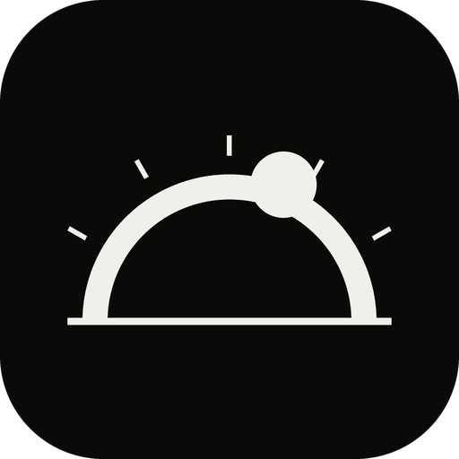

# أَثَر

**لا يُقاس يومك بعدد الساعات… بل بما تبقّى منه فيك.**

تطبيق صغير يعيش على جهازك، يقرأ إيقاعك، ويعيدك إلى الخطوة الواحدة التي تُحرّكك فعلًا.
بلا حساب، بلا سحابة، بلا ضجيج.

`يعمل دون إنترنت` · `بياناتك على جهازك` · `آيفون · أندرويد · كمبيوتر`

---

## الفكرة

بدأ السؤال من ملاحظة بسيطة: أكثر ما يوقفنا ليس نقص المعرفة، بل **كثرة الأوامر في مكان واحد**.
تطبيقات اللياقة تخبرك بعشرين رقمًا، وتطلب منك أن تقرّر — فتتوقف.

فبُني «أَثَر» على عكس ذلك تمامًا: **خطوة واحدة الآن، وأثر يتراكم**.
وعلى هذا المبدأ يقوم التطبيق كلّه:

> لا يهمّك أن تعرف كل شيء عن جسدك اليوم؛ يهمّك أن تعرف **الخطوة القادمة**.

## ما يجعل «أَثَر» مختلفًا

### أثر — نظام تقدّم يُرى ولا يُحسَب فقط
كل فعل صحي يمنحك **نقاط أثر**، والنقاط ترفعك عبر **عشرة مستويات** لها أسماء تشبه الحياة لا الألعاب:
*بداية الأثر · خطوة ثانية · إيقاع · ثبات · أُلفة · تجدّد · تمكين · أثر راسخ · صعود · أُفق.*

لكن النقاط في «أَثَر» ليست حيلة تحفيزية: **كل مصدر يمنح نقاطه مرة واحدة يوميًا، وله سقف عند هدفك**؛
ماء بعد هدفك، أو خطوات فوق حاجتك، لا تُحتسب — لأن الأثر يجب أن يبقى صدقًا مع جسدك.

### الخوارزمية التي تقرأ أسبوعك
محرّك هادئ يقرأ آخر سبعة أيام، ويحسب معدّل التزامك لكل مؤشر (ماء، حركة، نوم، مهام، مزاج)،
ثم يقارنه بفجوة اليوم، ويُخرج **اقتراحًا واحدًا فقط**: الخطوة الأعلى أثرًا الآن.
يعرف أن الماء أضعف مؤشراتك؟ يقترح كوبًا قبل أن يقترح تمرينًا. يعرف أنك تنام قليلًا؟ يبدأ بالنوم.
وفي سجلّ الأثر يُخبرك صراحةً *أين* يقف جسدك في الأسبوع — بلغة صريحة بلا مجاملة.

### الإدخال بملمس، لا بنماذج
بدل حقول الأرقام المملّة: **لوحة أرقام مخصّصة** تظهر عند الحاجة، أزرار سريعة («مثل الأمس»، «أقل ٠٫٥»)،
موجة لمس خفيفة تحت إصبعك على كل زر، وحفظ بضغطة واحدة. الوزن، النوم، السعرات — كلها بهذا الإيقاع.

### مظهر يُشبهك
صفحة إعدادات كاملة للمظهر: وضع داكن/فاتح، **ثلاثة أنواع خط** (عصري، كلاسيكي، أرقام)، **أربعة أحجام**،
و**ثلاثة أشكال للأثر** (متوازن، صارم، هادئ) تغيّر كرم النقاط وحِدّة التذكيرات — لأن التحفيز ليس مقاسًا واحدًا للجميع.

### مبنيّة للأصابع، لا للفأرة
مساحات لمس ≥ ٤٤px، اتجاه RTL أصيل، ترويسة تنسحب بلطف مع التمرير، شريط سفلي عائم فوق رمز الإيماء،
احترام `safe-area` في آيفون، وحشو خلفي يمنع الشريط من تغطية المحتوى. جرّبتها على ٣٦٠ · ٣٩٠ · ٤١٢ · ٤٣٠ بكسل — بلا تمرير أفقي واحد.

## كيف يكون «أَثَر» مساعدًا حقيقيًا للتطوّر؟
1. **يقيس ما يستطيع قياسه:** ماء، حركة، نوم، سعرات، مزاج، مهام، وزن، مواعيد — بلا حساسات ولا أجهزة.
2. **يُعيد الأثر إلى صاحبه:** خريطة التزام ٢٨ يومًا، منحنى وزن، أسبوع نقاط، سلسلة أيام متتابعة.
3. **لا يتركك في الفراغ:** تحدّي يومي متغيّر + خطوة مقترحة + إشعارات ذاتية عند تجاوز الوقت.
4. **يبدأ من مكانك:** ملف شخصي يحسب أيضك الأساسي واحتياجك اليومي، ثم يبني أهدافك عليه.
5. **يتركك ترحل وترجع:** تصدير/استيراد نسخة، ونسخة أمان داخلية — فلا تضيع سنوات من الأثر في تغيير جهاز.

## الخصوصية ليست ميزة هنا، بل الأساس
لا يوجد خادم. لا يوجد حساب. لا يوجد تتبّع ولا إعلانات ولا تحليلات.
كل بياناتك في ذاكرة جهازك (تخزين محلي + نسخة أمان)، ويمكنك تصديرها أو محوها في أي لحظة.

## إلى أين يمضي
- [ ] مؤقّت تنفّس موجّه (4-7-8) بحلقة تكبر وتصغر.
- [ ] استيراد من ملفات Apple Health / Google Fit (بلا ربط حسابات).
- [ ] قياسات أوسع: محيط الخصر، ضغط الدم، جودة النوم.
- [ ] مشاركة «بطاقة أثر» يولّدها المتصفح لمن يريد.
- [ ] أسبوع مرن: تجميد السلسلة يومًا واحدًا شهريًا.

---

**أَثَر** — ابدأ صغيرًا. اثبت. ثم انظر إلى الخلف.

